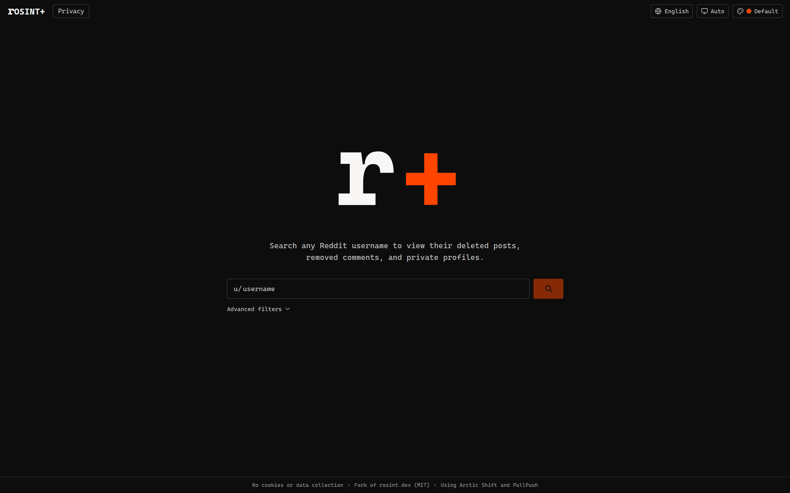
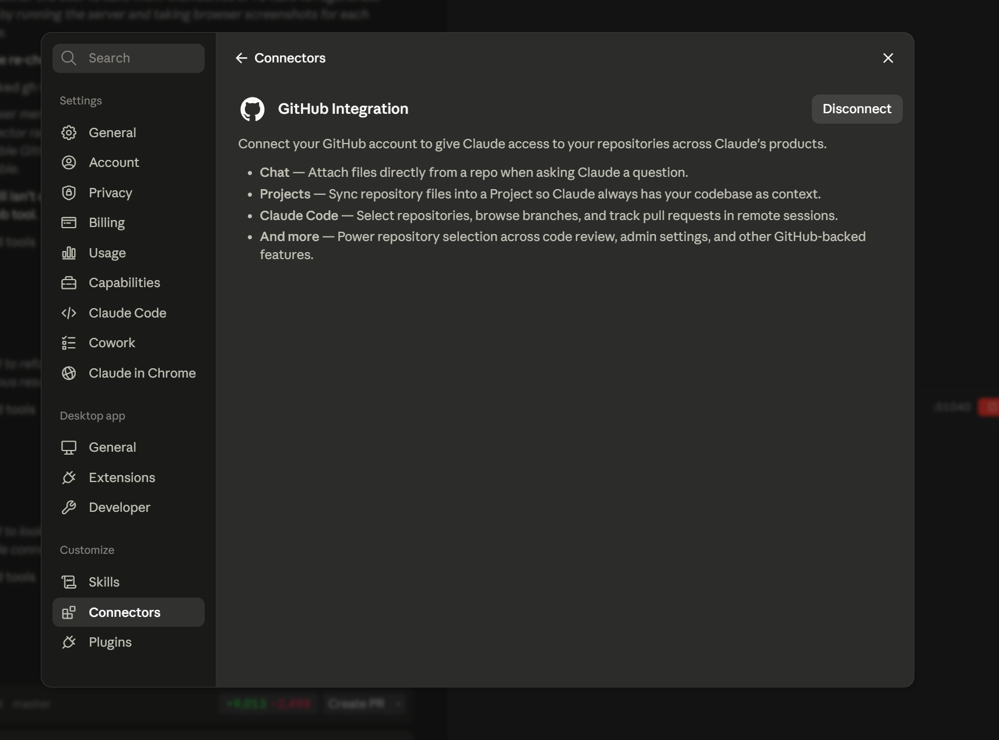
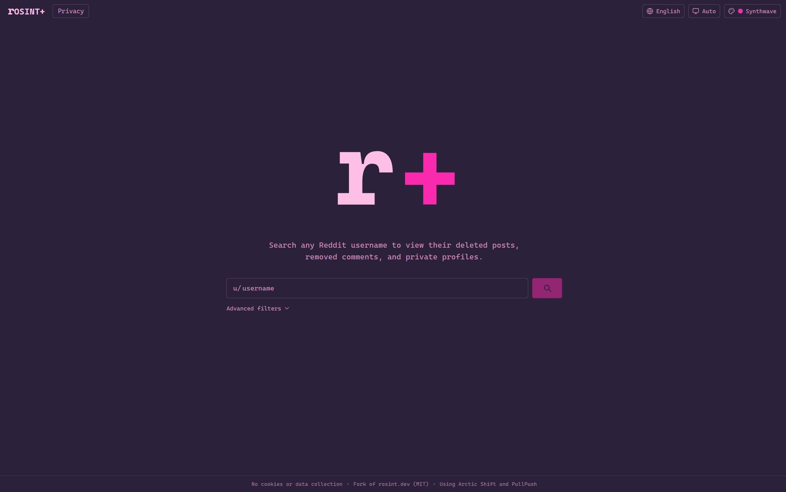
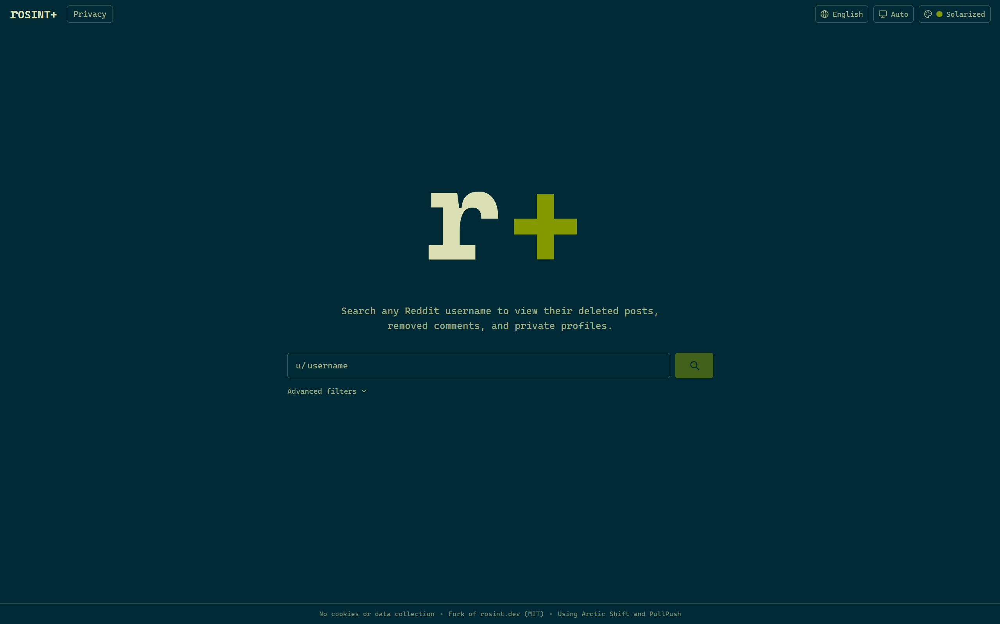
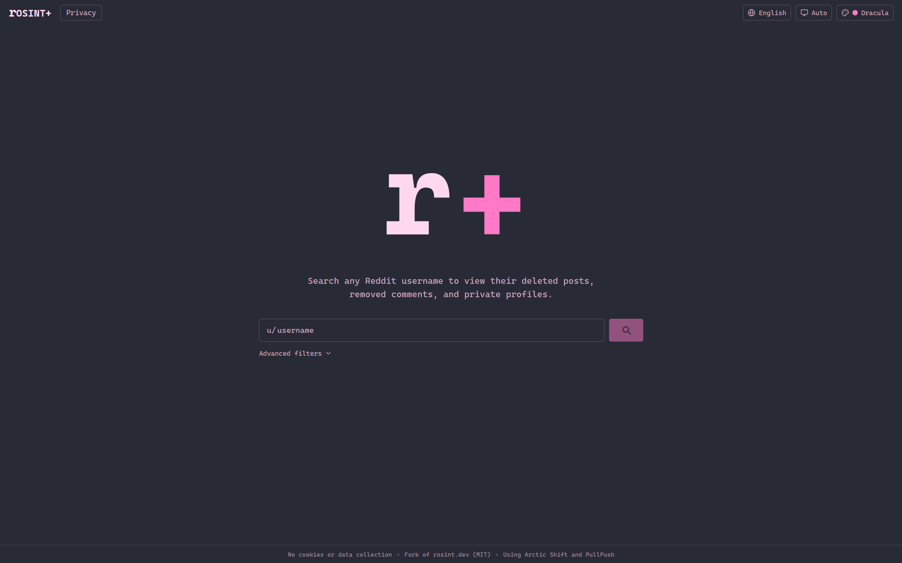
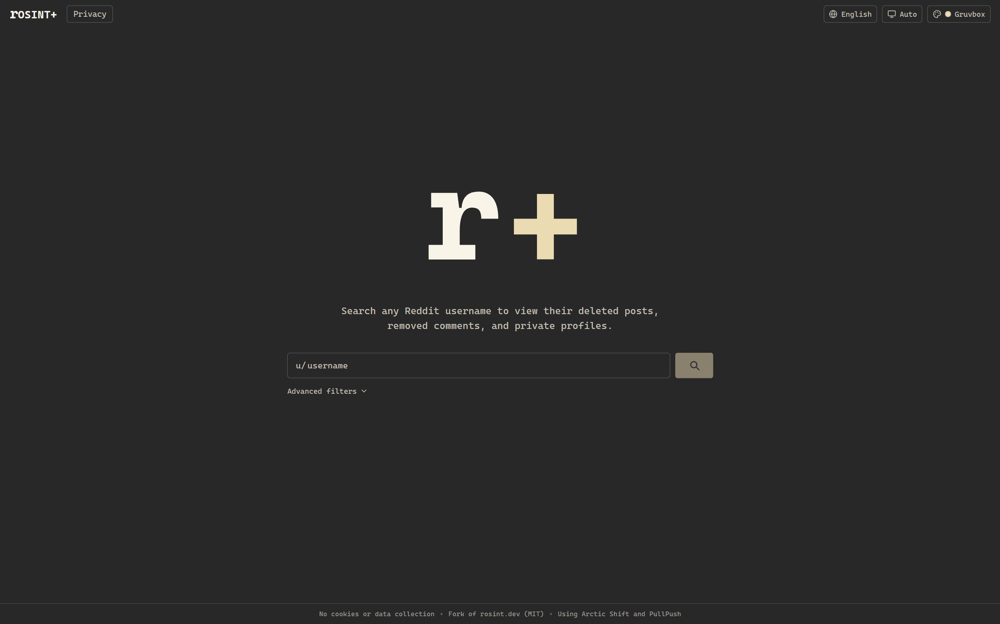
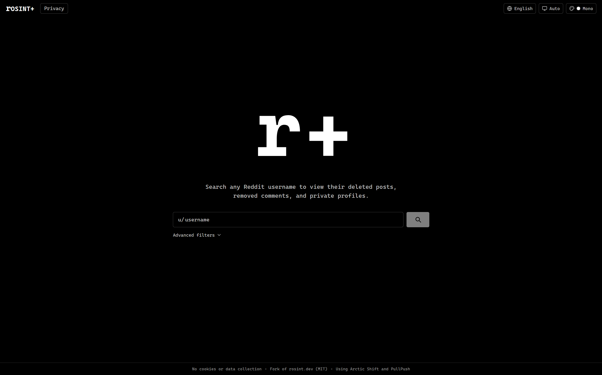
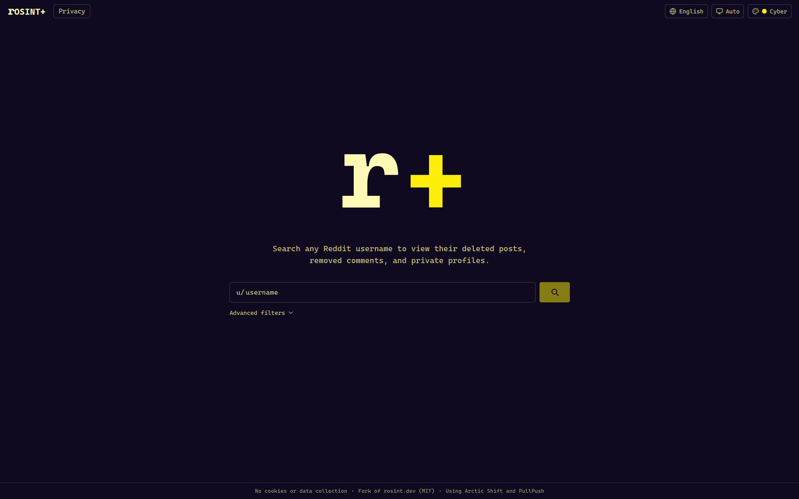
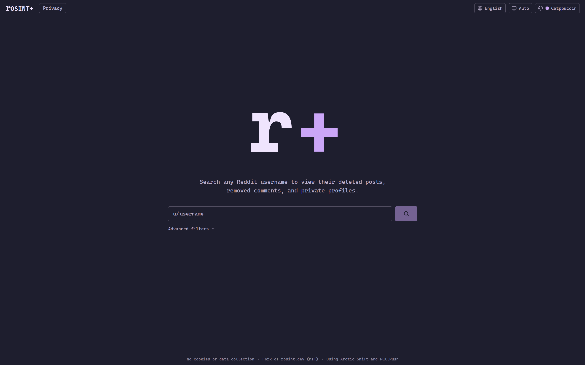
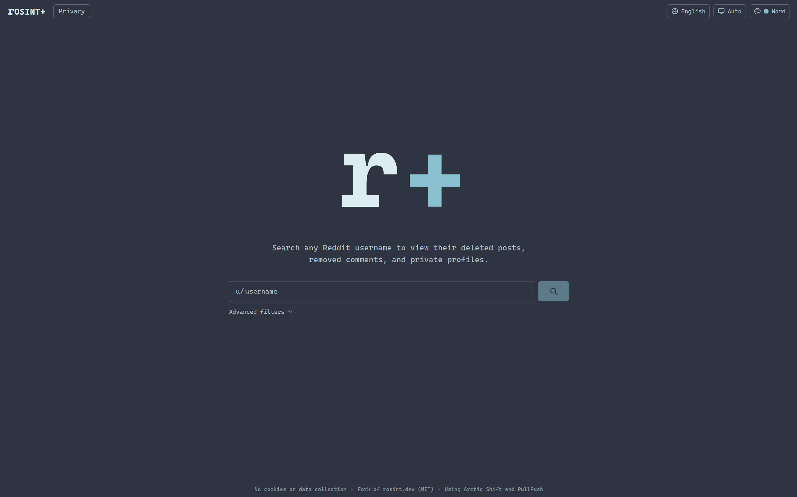

# Rosint+

**Reddit user intelligence tool**: search any Reddit user's full post and comment history, including private accounts, removed comments, and deleted content.

[rosintplus.github.io](https://rosintplus.github.io/)

This is a fork of **[rosint.dev](https://rosint.dev)** extended with profile analytics, saved profiles, themes, localization, and more.

Questions or feedback? Find me on Discord: **leskos144**

<table>
  <tr>
    <td></td>
    <td></td>
  </tr>
  <tr>
    <td colspan="2"></td>
  </tr>
</table>

## Features

- **Dual-source search** > Arctic Shift and PullPush queried in parallel, results merged and deduplicated by post/comment ID
- **Posts tab** > title, subreddit, score, comment count, timestamp, thumbnail, body snippet
- **Comments tab** > full comment body, subreddit, score, link to original thread
- **Date range filter** > filter results by before/after date using a calendar picker
- **Pagination** > timestamp-based cursor pagination (100 results per page)
- **No login required** > fully frontend, no backend, no auth

### Added in this fork

- **Profile analytics** - a stats panel with top subreddits, an activity heatmap (with an estimated timezone), and most-common words
- **Saved profiles** - pin profiles to disk (IndexedDB), plus recent-search history

- **Political compass** - a 3-axis ideological reading (economy / social / civil-authority) computed **locally in your browser** from the account's own comments, stated positions and community footprint. No API key and no network call. See [Political compass](#political-compass) for how it behaves.
- **No AI, no API key** - the compass is a deterministic statistical estimator that runs entirely in the browser. Nothing is sent anywhere, and there is no model to download.

- **9 color themes** - Default, Nord, Catppuccin, Cyber, Mono, Gruvbox, Dracula, Solarized, and Synthwave - each with light / dark / auto modes (see [Themes](#themes))
- **7 languages** - English, Spanish, French, German, Greek, Japanese, and Chinese
- **Export** - download the current result set as CSV or JSON
- **Copy permalink** - one click copies the permalink, timestamp, and details
- **Keyboard accessible** - visible focus rings, escape-to-close menus, and a skip-to-content link

## Political compass

The compass runs a deterministic statistical engine (`src/compass/`). There is no model,
no API call, and no key: it is a content-analysis estimator that you can audit and reason
about.

Two independent estimators are computed over the same account and then pooled:

**1. Text side - Laver & Garry (2000) pro/con balance.**
Political text is coded into dictionary categories (`src/compass/dictionary.js`), each
belonging to one policy dimension and one pole of it - the method used by the Comparative
Manifesto Project. A position is then the *relative balance* of the text units coding each
pole,

    U(PC) = (PC_pro - PC_con) / (PC_pro + PC_con)

which is bounded in +/-10 by construction and defined for a single text. Coding is done
per sentence so negation scope stays local ("I do not support X" does not code as
support), and questions are dropped because they ask about a position rather than assert
one.

**2. Community side - Poole-Rosenthal / Barbera-style ideal point.**
A user's distribution of activity across subreddits is treated like a roll-call record or a
follow graph: each community has a known position, and the user's ideal point is the
participation-weighted mean of them.

**Pooling.** The two estimates are combined by inverse-variance (Cochran) weighting, then
shrunk toward zero by their own uncertainty (empirical-Bayes shrinkage). Every score
travels with a standard error, and a dimension is *labelled* only when its 95% confidence
interval excludes zero. This is what couples extremity to confidence: a thin or
contradictory history reads as **centre / uncertain** rather than landing on an extreme.

Design rules the engine holds to:

- **Heuristics damp, they never invert.** Sarcasm markers widen the reported uncertainty;
  "arguing against this subreddit" reduces a community's weight as evidence of the user's
  own position. Neither reverses a direction. A heuristic that can flip an answer is a
  heuristic that produces nonsense answers.
- **Repetition is not evidence of breadth.** Uncertainty is clustered on *distinct
  categories*, so saying one phrase eighty times is one observation of one category, not
  eighty independent observations of position.
- **Duplicates are never double-counted.** Items reach the engine from the search results,
  the background crawl and the aggregated stats; they are pooled so that the same item is
  counted exactly once.
- **Labels are hysteretic.** The quadrant badge holds its previous value until the reading
  clearly leaves it, so it does not flicker while the background crawl is still loading.

The panel always shows the evidence basis (units, topic count, communities, standard
error) next to the reading, and is marked **Provisional** while the crawl is still running.

`npm test` runs the behavioural checks for this engine (`scripts/compass-check.mjs`),
including regression tests for double-counting and stale caching.

### References

- Laver, M. & Garry, J. (2000). *Estimating Policy Positions from Political Texts.*
  British Journal of Political Science 30(4): 611-632.
- Laver, M., Benoit, K. & Garry, J. (2003). *Extracting Policy Positions from Political
  Texts Using Words as Data.* American Political Science Review 97(2): 311-331.
- Martin, L. W. & Vanberg, G. (2007). *A Robust Transformation Procedure for Interpreting
  Political Text.* Political Analysis 16(1): 98-110.
- Poole, K. T. & Rosenthal, H. (1985). *A Spatial Model for Legislative Roll Call
  Analysis.* American Journal of Political Science 29(2): 357-384.
- Barbera, P. (2015). *Birds of the Same Feather Tweet Together.* American Journal of
  Political Science 59(3): 766-783.

## Themes

Nine built-in themes, each with light, dark, and auto (system) modes.

| | |
|---|---|
|  |  |
|  |  |
|  |  |
|  |  |

## Running locally

```bash
git clone https://github.com/rosintplus/rosintplus.github.io.git
cd rosintplus.github.io
npm install
npm run dev
```

Then open [http://localhost:5173](http://localhost:5173).

## APIs

Both APIs are queried with the same parameters:

```
Arctic Shift:  https://arctic-shift.photon-reddit.com/api/posts/search?author={username}&limit=100&sort=desc
PullPush:      https://api.pullpush.io/reddit/search/submission/?test&author={username}&limit=100&sort=desc
```

## Limitations

- Archive data may not capture all recent posts
- Arctic Shift and PullPush have no guaranteed uptime
- If both APIs are down, no results will be returned
- The political compass infers ideology from language and community context. It is a
  heuristic reading, not a fact about a person, and thin evidence deliberately produces
  "insufficient signal" rather than a confident-looking guess.

## API keys

This project ships **no API keys** and collects none. The political compass and all other
analytics run locally in the browser against public Reddit archives, and no account is
required. Nothing about your searches leaves your browser except the archive queries
themselves.

## Credits

- **[rosint.dev](https://rosint.dev)** - the original project this fork is based on
- [Arctic Shift](https://github.com/ArthurHeitmann/arctic_shift) by ArthurHeitmann
- [PullPush](https://pullpush.io)
- [Botometer (Indiana University OSoMe)](https://botometer.osome.iu.edu/) - temporal entropy and automation heuristics methodology
- [Reddit BotDefense / BotBuster](https://www.reddit.com/r/BotDefense/) - multi-subreddit carpet-bombing and submission depth heuristics
- [Navigating Multidimensional Ideologies with Reddit's Political Compass (ACM WWW '24)](https://github.com/arnestc/political-compass) - community polarity taxonomy and 2D ideological mapping methodology
- Laver & Garry (2000), Laver, Benoit & Garry (2003), Martin & Vanberg (2007) - text-scaling methodology behind the compass (see [Political compass](#political-compass))
- Poole & Rosenthal (1985) NOMINATE; Barbera (2015) - ideal-point estimation behind the community-footprint estimator
